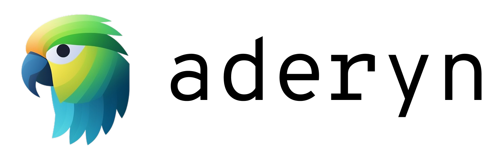

> **Aderyn is retired and no longer maintained.** There are no supported
> installation or upgrade paths. The usage and integration documentation below
> is retained for historical reference. Existing installations receive no updates
> or support.

<p align="center">
    <br />
    <a href="https://cyfrin.io/">
        </a>
    <br />
</p>
<p align="center"><strong>A powerful Solidity static analyzer that takes a bird's eye view over your smart contracts.
</strong></p>
<p align="center">
    <br />
    <a href="https://cyfrin.io/">
        </a>
    <br />
</p>

<p align="center">
<a href="https://cyfrin.gitbook.io/cyfrin-docs/aderyn-cli/readme">Docs</a>
<a href="https://discord.gg/cyfrin">Discord</a>
<a href="https://x.com/cyfrin">X/Twitter</a>
<p>

---

<div align="center">

[![Stargazers][stars-shield]][stars-url] [![Forks][forks-shield]][forks-url]
[![Contributors][contributors-shield]][contributors-url]
[![Release][release-shield]][release-url]
[![Issues][issues-shield]][issues-url]
[![GPL-3.0 License][license-shield]][license-url]

</div>

## What is Aderyn?

**Aderyn is an open-source public good developer tool.** It is a Rust-based solidity smart contract static analyzer designed to help protocol engineers and security researchers find vulnerabilities in Solidity code bases.

You can read the [Cyfrin official documentation](https://cyfrin.gitbook.io/cyfrin-docs/aderyn-cli/readme) for an in-depth look at Aderyn's functionalities.

The [VS Code extension](https://github.com/Cyfrin/vscode-aderyn/) is also retired
and has been delisted from the Visual Studio Marketplace.

## Features

- Runs without need for any configuration support for Foundry and Hardhat projects.
- Creates Markdown, JSON and Sarif reports.
- Previously powered the [VS Code extension](https://github.com/Cyfrin/vscode-aderyn/).
- List of [supported detectors](https://cyfrin.gitbook.io/cyfrin-docs/project-configuration/list-of-supported-detectors)
- Contributor Friendly
- Downloaded more than 45K times. 

## Installation and removal

Aderyn installation and upgrades are no longer supported through Homebrew, npm,
Cyfrinup, or the shell installer. Legacy installer scripts and release assets may
remain accessible during retirement; they are not supported installation paths.

#### Homebrew

The Aderyn Homebrew package is retired. Remove an existing installation with:

```sh
brew uninstall cyfrin/tap/aderyn
```

#### npm

The Aderyn npm package is retired. Remove an existing global installation with:

```sh
npm uninstall --global @cyfrin/aderyn
```

## Quick Start (historical)

Run `aderyn --version` to check if Aderyn is installed successfully.

[Quick Start](https://cyfrin.gitbook.io/cyfrin-docs/aderyn-cli/quickstart) example with video guide.

```
cd path/to/solidity/project/root
aderyn
```

This generates a [report.md](https://github.com/Cyfrin/aderyn/blob/dev/reports/report.md)

See examples using more CLI options [here](https://cyfrin.gitbook.io/cyfrin-docs/cli-options)

## VS Code extension

The [VS Code extension](https://github.com/Cyfrin/vscode-aderyn/) is retired and
has been delisted from the Visual Studio Marketplace. Existing users can uninstall
Aderyn from VS Code's Extensions view.

## Github Action

The historical [Aderyn CI Assistant](https://github.com/marketplace/actions/aderyn-ci-assistant)
integration performed static analysis on Solidity codebases in CI. This integration
is no longer supported.

## Contributing & License

Historical developer setup and contribution information is retained in the
[contribution guidelines](./CONTRIBUTING.md).
Aderyn is an open-source software licensed under the [GPL-3.0 License](./LICENSE).

To learn how to create your custom Aderyn detectors, [checkout the official docs](https://cyfrin.gitbook.io/cyfrin-docs/aderyn-cli/detectors-quickstart)

Aderyn relies on a [custom backend](https://github.com/Cyfrin/solidity-ast-rs) to generate AST for Solidity codebases. 
It leverages [foundry-compilers](https://github.com/foundry-rs/compilers) 

## Credits

This project exists thanks to all the people who [contribute](/CONTRIBUTING.md).<br>

<a href="https://github.com/cyfrin/Aderyn/graphs/contributors">
  
</a>

## Attribution

- Initial inspiration for AST Visitor code from [solc-ast-rs](https://github.com/hrkrshnn/solc-ast-rs).
- Original detectors based on [4naly3er](https://github.com/Picodes/4naly3er) detectors.
- Shoutout to the original king of static analysis [slither](https://github.com/crytic/slither).


[contributors-shield]: https://img.shields.io/github/contributors/cyfrin/aderyn
[contributors-url]: https://github.com/cyfrin/aderyn/graphs/contributors
[forks-shield]: https://img.shields.io/github/forks/cyfrin/aderyn
[forks-url]: https://github.com/cyfrin/aderyn/network/members
[stars-shield]: https://img.shields.io/github/stars/cyfrin/aderyn
[stars-url]: https://github.com/cyfrin/aderyn/stargazers
[release-shield]: https://img.shields.io/github/v/release/Cyfrin/aderyn
[release-url]: https://github.com/Cyfrin/aderyn/releases
[issues-shield]: https://img.shields.io/github/issues/cyfrin/aderyn
[issues-url]: https://github.com/cyfrin/aderyn/issues
[license-shield]: https://img.shields.io/github/license/cyfrin/aderyn?logoColor=%23fff&color=blue
[license-url]: https://github.com/cyfrin/aderyn/blob/master/LICENSE
[linkedin-shield]: https://img.shields.io/badge/-LinkedIn-black.svg?style=for-the-badge&logo=linkedin&colorB=555
